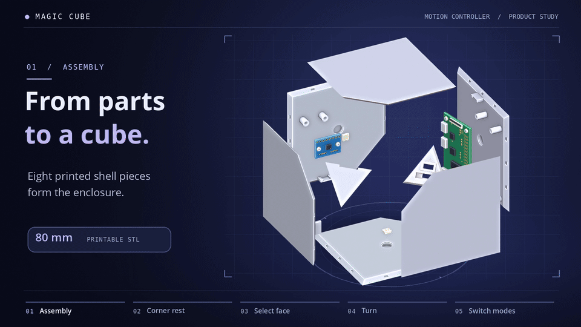
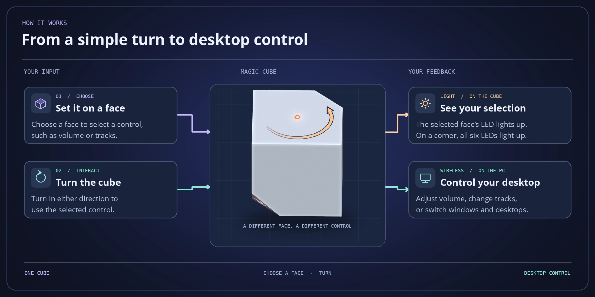
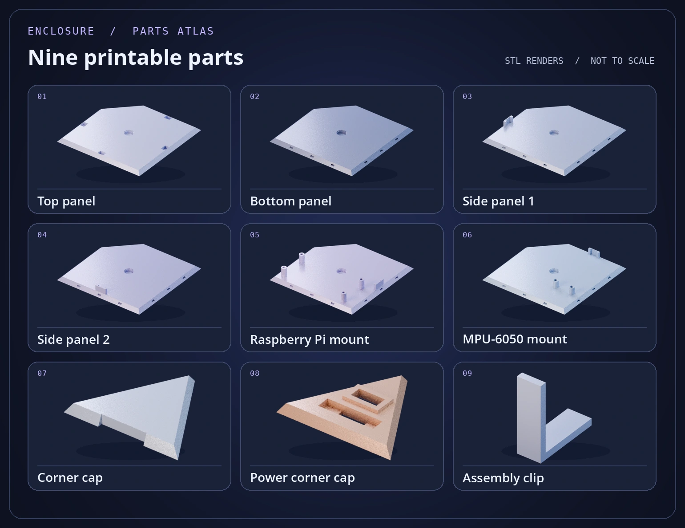

<div align="center">

# Magic Cube

A wireless motion controller for Windows, built with a Raspberry Pi and a 3D-printable enclosure.

**Raspberry Pi Zero W · MPU-6050 · RGB LEDs · Python**

[How it works](#how-it-works) &nbsp;·&nbsp; [Enclosure](#the-enclosure) &nbsp;·&nbsp; [Original demo](#see-it-in-action) &nbsp;·&nbsp; [Build your own](#build-your-own)

</div>

[](docs/visuals/magic-cube-animation.mp4)

<div align="center">

[Watch the animation in 1080p](docs/visuals/magic-cube-animation.mp4) &nbsp;·&nbsp; [See the original demo](#see-it-in-action)

</div>

## How it works

**Set the cube on a face to choose a control. Turn it to use that control.** The same turn can change the volume, skip a track, or switch windows, depending on which face is active.

[](docs/visuals/how-it-works.webp)

Each assigned face selects an action. The active face’s LED lights up, and turning the cube sends the corresponding command to the Windows PC. Rest it on a flat corner and all six LEDs light up.

### Default controls

| Detected face | Assigned action | Rotation controls |
|:---:|---|---|
| 0 | Switch desktops | Move between Windows virtual desktops |
| 1 | Switch windows | Navigate the Windows app switcher |
| 2 | Unassigned | Available for a custom action |
| 3 | Change song | Previous / next track |
| 4 | Change volume | Volume down / up |
| 5 | Unassigned | Available for a custom action |

Face numbers are sensor orientations defined in the code; their physical positions depend on how the sensor is mounted. Actions and thresholds can be changed in [`PC App/MagicCube.py`](PC%20App/MagicCube.py).

## The enclosure

The **80 × 80 × 80 mm** enclosure has a triangular resting cap at each of two opposite corners. The third iteration was 3D printed; the first two were made from 3 mm plywood. Magnets hold the removable top, and two of the panels have built-in mounts for the Pi and the sensor.

[](docs/visuals/enclosure-parts.webp)

[Browse all nine STL files](3d%20files/) · [Pi mounting panel](3d%20files/CubeFace-RasPi.stl) · [MPU-6050 mounting panel](3d%20files/CubeFace-MPU6050.stl)

## See it in action

See the original physical build in action:

<a href="https://youtu.be/o7vy6GcWytc"></a>

**[Watch the original demonstration](https://youtu.be/o7vy6GcWytc)** · [Earlier demo](https://www.youtube.com/watch?v=zX449j0VkWc) · [Original build photos](https://imgur.com/a/eOWr2kO)

## Build your own

### Hardware

| Component | Role |
|---|---|
| Raspberry Pi Zero W | Onboard processing and Wi-Fi; the original project also reports testing a Pi 3 B+ |
| MPU-6050 | Accelerometer and gyroscope for face and motion detection |
| 6 × WS2812B LEDs | Individually addressable color feedback |
| 2 × 18650 batteries, TP4056 charger and switch | Original portable power components |
| 8 × approximately 1.5 × 0.5 mm magnets | Hold the removable top face |
| Printed enclosure | Cube faces, internal mounts and triangular supports |

The optional [assembly clip](3d%20files/CubeFace_Holder.stl) helps align or join the panels. The original build notes specify gluing the triangular caps.

> **Before wiring:** The repository does not include a complete schematic or battery protection design. Verify the supply voltage, current, charging and protection requirements for your exact battery, charger, Pi and LEDs before assembly. Check the WS2812B data and power requirements for your particular setup, including whether a logic-level shifter is needed.

### 1. Prepare the Raspberry Pi

1. Assemble the cube and connect the MPU-6050 to the Pi's I²C bus. The code uses **bus 1** and sensor address **`0x69`**; configure the sensor's address pin accordingly, or update [`RPi/mpu6050_Interface.py`](RPi/mpu6050_Interface.py). Check the voltage requirements of your specific sensor board; the original build used 3.3 V.
2. Connect the LED data input to **GPIO 18 / `D18`** and provide suitable power and a common ground. The code expects six LEDs in GRB order.
3. Install Raspberry Pi OS, connect the Pi and PC to the same network, and enable I²C. The original build used a 400 kHz I²C bus. Enable SSH if you plan to run the Pi remotely.
4. Give the Pi a hostname or IP address reachable from the PC. The default client hostname is `MagicCube`; an IP address can be used instead.
5. Clone this repository onto the Pi and install the Python dependencies. For a Raspberry Pi OS installation with `apt`, one way to keep the Python packages together is:

   ```bash
   sudo apt update
   sudo apt install git python3-venv python3-smbus
   git clone https://github.com/TheGuy42/MagicCube.git
   cd MagicCube/RPi
   python3 -m venv --system-site-packages .venv
   .venv/bin/python -m pip install rpi_ws281x adafruit-circuitpython-neopixel
   ```

   The repository contains an older Windows virtual environment; create an environment for your own system instead of relying on that copy. The code has no pinned dependency manifest, so compatible package versions may depend on your Pi OS and hardware.

6. Adjust the LED presets in [`RPi/config.py`](RPi/config.py) to match the order in which your LEDs are wired.

### 2. Start and calibrate the cube

From the `RPi` directory, start the Pi program in a terminal where you can see its prompts:

```bash
sudo .venv/bin/python MagicCube.py
```

On the first run, the program calibrates the gyroscope and then guides you through accelerometer calibration for all six faces. Keep the cube still during measurements and follow the prompts. Calibration files are saved in the current working directory and reused on later runs. Run the command from the same directory each time so those files can be found.

The Pi then waits for the PC client to connect. The default TCP port is **123**. The original instructions run the Pi process with `sudo`; this also gives the program access to the hardware and the default privileged port. If you change the port, update it on both the Pi and PC.

### 3. Start the Windows client

1. Clone the repository on the PC and install Python 3 with Tkinter available. The keyboard implementation uses the Windows `SendInput` API, so the supplied desktop controls are **Windows-specific**.
2. In [`PC App/MagicCube.py`](PC%20App/MagicCube.py), set `pi_hostname` inside `Configure.AppDefaultSettings` to the Pi's reachable hostname or IP address. The `port` must match `CubeConfig.port` in [`RPi/config.py`](RPi/config.py).
3. Start the client from the `PC App` directory:

   ```powershell
   cd "MagicCube\PC App"
   python MagicCube.py
   ```

4. Place the cube on a face and rotate it to use its assigned action. The client connects and starts streaming automatically. Stop it with `Ctrl+C`.

The repository also contains an experimental Tkinter GUI, but it is disabled by default and the original project notes that it has bugs.

> **Network scope:** The connection is unauthenticated and deserializes Python pickle data on both ends. Use it only on a trusted, isolated network; do not expose its port to the internet or untrusted devices. Load only trusted local `.pickle` settings and calibration files.

## Configuration

| What to change | File | Settings |
|---|---|---|
| Connection | [`PC App/MagicCube.py`](PC%20App/MagicCube.py) | `pi_hostname` and `port` in `Configure.AppDefaultSettings` |
| Face actions | [`PC App/MagicCube.py`](PC%20App/MagicCube.py) | `Func_Key` maps the six face indices to entries in `AppFunctionDict` |
| Motion sensitivity | [`PC App/MagicCube.py`](PC%20App/MagicCube.py) | Per-action `threshold` values and `CountBufferLength` |
| LED appearance | [`RPi/config.py`](RPi/config.py) | Colors, brightness, face presets and LED order |
| Sensor and server | [`RPi/config.py`](RPi/config.py) | Detection thresholds, calibration filenames and server port |

A saved `AppSettings.pickle`, if present in the client's working directory, is loaded after the default settings and can override code changes. Calibration files on the Pi are likewise relative to the working directory.

## Repository guide

| Path | Contents |
|---|---|
| [`RPi/`](RPi/) | Sensor processing, calibration, LED feedback and TCP server |
| [`PC App/`](PC%20App/) | Windows client, face-to-action mappings and experimental GUI |
| [`3d files/`](3d%20files/) | STL files for the enclosure and component mounts |
| [`docs/visuals/`](docs/visuals/) | Animation and README visuals |
